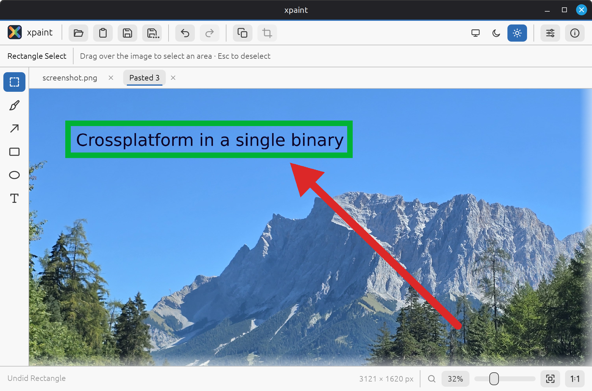
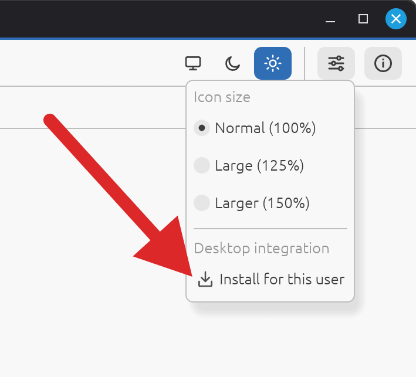

# xpaint

A simple, fast image editor for Linux in a single binary. Open a screenshot,
crop it, add arrows, boxes and text, and save it again.

<p align="center">
    
</p>

## Download
Prebuilt binaries for Linux and Windows are attached to each [release](https://github.com/matz0r/xpaint/releases).

### Optional install
<p align="center">
    
</p>

## Manual Installation

xpaint is a single program file with nothing else to install.

1. Download the latest `xpaint-…-x86_64-linux.tar.gz` from the
   [releases page](https://github.com/matz0r/xpaint/releases) and unpack it.
2. Run `xpaint` from the unpacked folder: double-click it, or run `./xpaint` in a terminal.

That's it. It runs on 64-bit Linux distributions from about 2024 on.

### Adding xpaint to your application menu

To start xpaint like any other app, open **Settings** (the sliders icon at the top
right) and choose **Install for this user**. This:

- copies xpaint to `~/.local/bin/xpaint`, so `xpaint` also works in a terminal
- adds it to your application menu, with its icon
- offers it in "Open with…" for image files

It's only for your user and needs no root password. Afterwards you can delete the
downloaded folder.

To update, start the newly downloaded xpaint and choose **Settings → Update
installation**. To remove xpaint again, choose **Settings → Uninstall**.

## Features

- **Tabs** for working on several images at once
- **Paste from clipboard** straight into a new image, which suits screenshots
- **Select and crop**
- **Drawing tools:** brush, arrow, rectangle, ellipse and text, with adjustable color, line width, font size and bold
- **Shapes and text stay editable** until you move on. Move them with the mouse or arrow keys, change their color or size, or delete them.
- **Undo / redo** for every edit
- **Zoom** with Ctrl + mouse wheel, the zoom slider, fit to window, or back to 100%
- **Opens** PNG, JPEG, BMP, GIF, TGA, TIFF, WebP, ICO and QOI
- **Saves** PNG, JPEG, WebP, BMP, GIF, TIFF, TGA and QOI. Transparent areas turn white when saving as JPEG.
- **Adjustable icon size** (Normal, Large, Larger) in the Settings menu, remembered between runs
- **Installs itself** into your application menu from the Settings menu
- Works on Wayland and X11

## Usage

Start xpaint from your application menu (once installed), or from a terminal, optionally with images to open:

```sh
xpaint screenshot.png photo.jpg
```

Images given on the command line each open in their own tab.

### Tools

| Tool             | Key | Notes                                                       |
|------------------|-----|-------------------------------------------------------------|
| Rectangle Select | S   | Drag to select an area                                      |
| Brush            | B   | Freehand drawing; a click paints a dot                      |
| Arrow            | A   | Drag from the start to the arrow tip                        |
| Rectangle        | R   | Hold Shift for a square                                     |
| Ellipse          | E   | Hold Shift for a circle                                     |
| Text             | T   | Click to place text, then type; Enter starts a new line     |

A shape or text you just made floats above the image until you commit it:

- **Drag** it, or use the **arrow keys** (1 pixel; hold Shift for 10 pixels), to move it
- Change the color, width or font size in the toolbar to restyle it
- **Delete** removes it
- **Esc** commits it to the image. Switching tools, saving, cropping and undo commit it too.

While typing text, **Esc** stops typing so you can move or restyle the text.

### Keyboard shortcuts

Most shortcuts are the same as in paint.net.

| Action                     | Shortcut                 |
|----------------------------|--------------------------|
| Open image                 | Ctrl+O                   |
| Save                       | Ctrl+S                   |
| Save as                    | Ctrl+Shift+S             |
| New image from clipboard   | Ctrl+Alt+V               |
| Undo                       | Ctrl+Z                   |
| Redo                       | Ctrl+Y or Ctrl+Shift+Z   |
| Crop to selection          | Ctrl+Shift+X             |
| Deselect                   | Ctrl+D or Esc            |
| Zoom to fit window         | Ctrl+B                   |
| Zoom to 100%               | Ctrl+0                   |
| Zoom in / out              | Ctrl + mouse wheel       |
| Close tab                  | Middle-click the tab     |

## Development

Building from source, running the tests and making releases is described in
[DEVELOPMENT.md](DEVELOPMENT.md).

## License

xpaint is released under the [MIT License](LICENSE).

The bundled DejaVu fonts are under their own license; see `assets/fonts/DejaVu-LICENSE.txt`.
